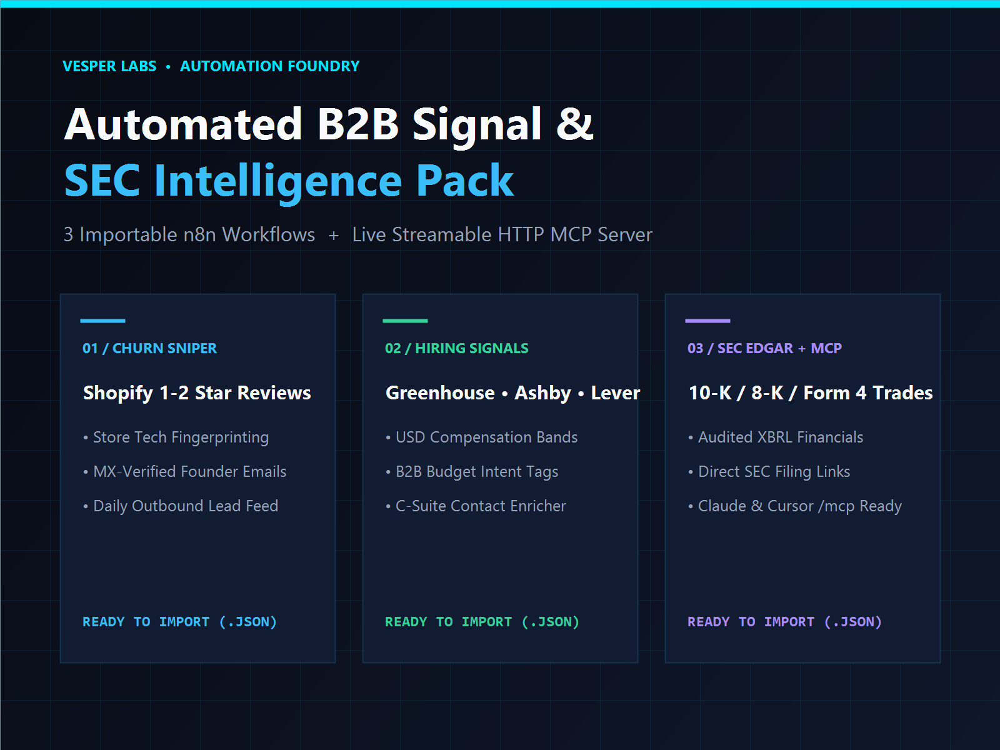

# Vesper Labs — SEC EDGAR MCP Server & B2B Signal Automation Suite



Deterministic, sub-second **Model Context Protocol (MCP)** tools and **n8n / Make / Clay** data pipelines for **SEC EDGAR financial disclosures**, **Multi-ATS hiring intent signals**, **Shopify tech-stack intelligence**, **SaaS competitor churn reviews**, and **live DNS MX-verified contact enrichment**.

---

## 🔌 Quickstart: Connect Claude Desktop, Cursor, or Windsurf to Live SEC EDGAR (`/mcp`)

Our **Standby Streamable HTTP MCP Server** (`2025-03-26`) connects directly to official US SEC EDGAR (`data.sec.gov`) and live DNS infrastructure with zero local Python/Docker setup.

Add [`mcp/claude_desktop_config.json`](./mcp/claude_desktop_config.json) (or `.cursor/mcp.json`):

```json
{
  "mcpServers": {
    "vesper-sec-edgar-b2b": {
      "url": "https://vesper26--sec-edgar-filings-mcp-server.apify.actor/mcp",
      "headers": {
        "Authorization": "Bearer <YOUR_APIFY_API_TOKEN>"
      }
    }
  }
}
```

### Exposed MCP Tools
| Tool Name | What It Returns | Latency |
| :--- | :--- | :--- |
| `get_sec_company_filings` | Live `10-K`, `10-Q`, `8-K`, `Form 4` insider transactions, `13F-HR`, and `S-1` filings + direct `sec.gov/Archives` document URLs | ~250ms |
| `get_sec_xbrl_financials` | Latest audited USD `Revenue`, `Net Income`, `Operating Income`, `Cash`, `Total Assets`, `Total Liabilities`, and `R&D` from SEC XBRL `CompanyFacts` | ~300ms |
| `verify_company_domain_dns` | Real-time DNS `MX` & `SPF` mail-provider fingerprinting (`Google Workspace`, `Microsoft 365`, `Proofpoint`, `Mimecast`) | ~120ms |

---

## 🚀 Live Data Endpoints & Actors (Apify Store)

All five Actors run pure deterministic Node.js (zero LLM hallucination, zero residential proxy bloat) and support **Agentic Payments**:

1. **[SEC EDGAR Filings, Financials & Insider Trades MCP Server](https://apify.com/vesper26/sec-edgar-filings-mcp-server)** — Batch SEC filing extractor + live `/mcp` server (`$1.50 / 1k items`).
2. **[B2B Verified Contact & Decision-Maker Email Enricher](https://apify.com/vesper26/b2b-verified-contact-scraper)** — Cloudflare `data-cfemail` decoding, `/team` & JSON-LD leadership extraction, live MX/SPF verification, and executive email permutations (`$2.00 / 1k domains`).
3. **[Multi-ATS Career Site Jobs & B2B Hiring Signals](https://apify.com/vesper26/ats-hiring-signal-scraper)** — Direct Greenhouse, Ashby, and Lever job feeds with normalized USD compensation and B2B budget tags (`$0.80 / 1k jobs`).
4. **[SaaS & Shopify App Reviews + B2B Churn Signal Scraper](https://apify.com/vesper26/saas-reviews-churn-signal-scraper)** — Extracts 1–3★ Shopify & Apple App Store reviews with merchant store names, tenure, and churn reason tags (`$1.20 / 1k reviews`).
5. **[Shopify Store Products, Pricing, Stock & Tech-Stack Scraper](https://apify.com/vesper26/shopify-store-intelligence-scraper)** — Detects `myshopify.com` domain, active theme, installed marketing apps/pixels (`Klaviyo`, `Gorgias`, `Recharge`), and live variant stock (`$0.90 / 1k items`).

---

## ⚡ Ready-to-Import `n8n` Workflow Blueprints

* **Free Starter Included Here:** [`examples/sec-edgar-insider-alert-starter.json`](./examples/sec-edgar-insider-alert-starter.json) — Automated 6-hour SEC `Form 4` insider trade, `8-K`, and audited XBRL financial briefing workflow.
* **Complete 3-Workflow B2B Signal & Churn Pack:** Grab all three production n8n pipelines (*Shopify Competitor Churn $\rightarrow$ Verified Founder Emails*, *Multi-ATS Hiring Signals $\rightarrow$ C-Suite Enricher*, and *SEC EDGAR Executive Monitor*) at **[vesperlabs.lemonsqueezy.com](https://vesperlabs.lemonsqueezy.com)**.

---

## ⚖️ Acceptable Use & Compliance
All tools operate strictly as ephemeral, user-directed utilities querying publicly accessible web metadata, public DNS records, and public-domain U.S. SEC EDGAR disclosures. Vesper Labs maintains zero centralized databases of personal information. End users act as independent Data Controllers responsible for GDPR, UK GDPR, CCPA, and CAN-SPAM compliance, and SEC data is provided strictly for informational research (not investment advice).
